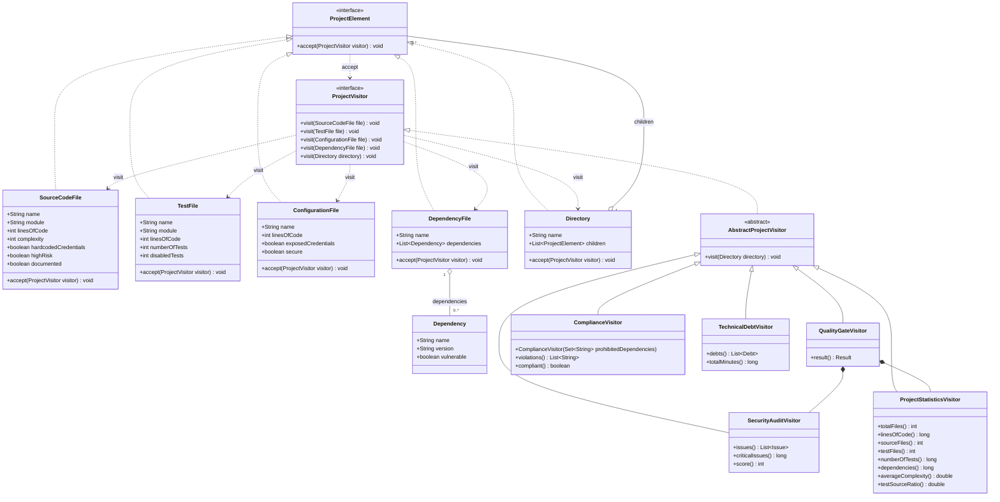
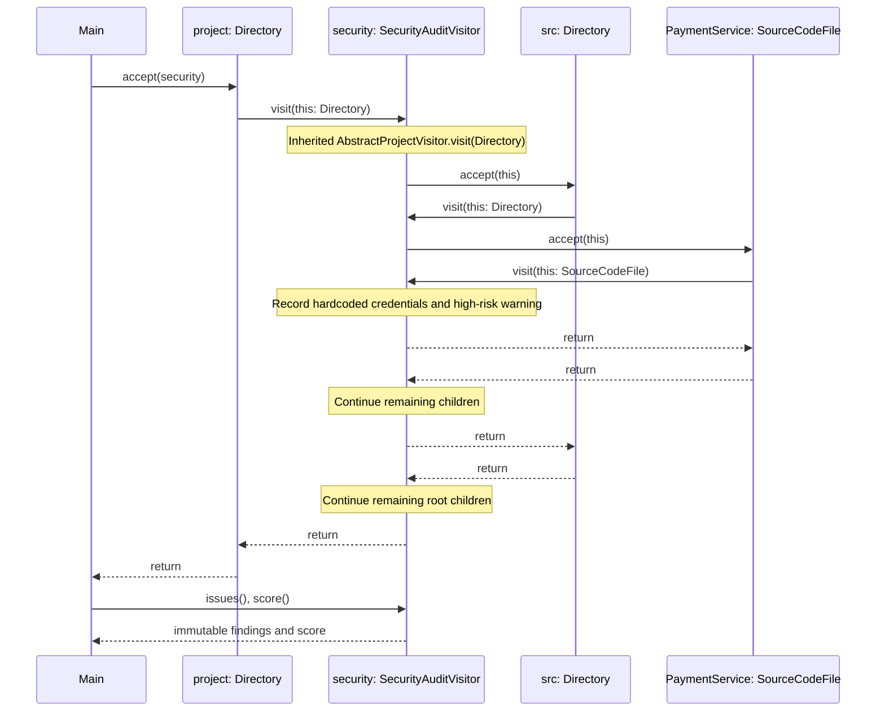

# Smart Code Inspection and Compliance Engine

Java 17+ application demonstrating the Visitor pattern. Five visitors inspect the same immutable fintech project model: security audit, statistics, release quality, compliance and technical debt.

## Build and run

Requires JDK 17 or newer. Gradle Wrapper is included; the first run downloads Gradle and JUnit dependencies.

```bash
./gradlew clean test
./gradlew run
./gradlew build
```

On Windows, use `gradlew.bat` instead of `./gradlew`. The HTML test report is generated at `build/reports/tests/test/index.html`.

## Demo project

```text
fintech-project/
├── src/
│   ├── PaymentService.java
│   └── UserService.java
├── tests/
│   └── PaymentServiceTest.java
├── config/
│   └── application.properties
└── build.gradle
```

`DemoProject` constructs this structure in memory. The dependency manifest is represented as `build.gradle` because this project uses Gradle. The engine operates on supplied metadata; it does not parse files or query vulnerability databases. Dependency names and vulnerability flags in the demonstration are fictional fixtures.

Each source file has a module identifier, lines of code, complexity and security/documentation flags. Test files record their module, lines, total tests and disabled tests. Configuration files record lines and security flags. Dependency manifests contain dependency names, versions and vulnerability flags. Directories contain immutable lists of elements, including other directories.

### Inspection rules

- **SecurityAuditVisitor:** hardcoded source credentials, exposed configuration credentials, insecure configuration and vulnerable dependencies are critical issues. A high-risk source flag produces a warning. The score starts at 100, subtracts 25 per critical issue and 10 per warning, and is bounded below by zero.
- **ProjectStatisticsVisitor:** counts all non-directory elements as files. Lines of code include source, test and configuration lines; dependency manifests have no line-count field. Tests include disabled tests. Dependencies count declarations, without deduplication. Average complexity uses only source files. Test/source ratio is the number of test files divided by source files, not code coverage. Both averages are zero when there are no source files.
- **QualityGateVisitor:** requires zero critical security issues, average complexity at most 10 and a test/source file ratio of at least 0.40. A project without source files fails the tests criterion. This visitor composes the security and statistics visitors to share their rules.
- **ComplianceVisitor:** rejects exposed credentials, missing dependency versions and explicitly prohibited dependency names. Every production module must have at least one active test. All source modules are production modules. Matching uses exact module identifiers and is independent of traversal order. This module-level requirement is separate from the Quality Gate's file-count ratio.
- **TechnicalDebtVisitor:** estimates 30 minutes per complexity point above 10, 15 minutes per undocumented source file and 10 minutes per disabled test. Configuration and dependency elements contribute zero to this estimate. These are fixed demonstration estimates, not measured remediation times.

Visitors accumulate results during a traversal. Use a new visitor instance for each independent inspection. Report collections are immutable snapshots. The directory visitor traverses children recursively; directories themselves are not counted as files. Immutable construction prevents ordinary cyclic directory structures. Extremely deep trees remain subject to the JVM call-stack limit.

### Demo results

The demo reports 5 files, 415 lines, 8 tests, 3 dependencies, average complexity 10.00 and a test/source ratio of 0.50. Security finds 4 critical issues and 1 warning, yielding a score of 0/100.

```text
Security: FAIL
Complexity: PASS
Tests: PASS

FINAL RESULT: FAILED
```

Compliance identifies credentials in `PaymentService.java` and `application.properties`, an unspecified version and prohibited use of `org.example:legacy-auth`, and the `users` module's missing tests. Estimated technical debt is 145 minutes.

## Architecture

### What problem does Visitor solve?

Different operations need to process the same heterogeneous project tree. Visitor keeps the inspection algorithms separate from file data and allows new operations without changing the element classes.

### Where are Element and Visitor?

All implementation classes are in `src/main/java/com/fintech/inspection`. `ProjectElement` is the element interface; `SourceCodeFile`, `TestFile`, `ConfigurationFile`, `DependencyFile` and `Directory` implement it. `ProjectVisitor` declares one overload per element type. `AbstractProjectVisitor` provides recursive directory traversal and default no-op file visits. The five concrete visitors implement the relevant operations.

### What is double dispatch?

First, `element.accept(visitor)` dynamically selects the concrete element's `accept()` method. Inside that method, `visitor.visit(this)` selects the overload corresponding to the concrete element type at compile time and dispatches to the actual visitor's implementation at runtime. The behavior therefore depends on both the element and the visitor. Every concrete element implements exactly this delegation; there are no element-type checks or type switches.

### Why not put every operation inside elements?

Security rules, quality thresholds and reporting change independently of file data. Putting every operation in each element would mix responsibilities and require editing the entire hierarchy when adding an operation. Elements instead hold validated immutable data and the dispatch method.

### Is adding a visitor or an element easier?

Adding a visitor is easier: implement `ProjectVisitor` or extend `AbstractProjectVisitor`, then pass the new visitor to the existing tree. `TechnicalDebtVisitor` was added in its own commit without modifying any element class or the visitor interface.

### What changes for DatabaseMigrationFile?

1. Add `DatabaseMigrationFile implements ProjectElement`, with meaningful migration data and `accept(ProjectVisitor visitor) { visitor.visit(this); }`.
2. Add `void visit(DatabaseMigrationFile file)` to `ProjectVisitor`; without this overload the new `accept()` cannot compile.
3. Add an implementation to `AbstractProjectVisitor`. Without that change, its concrete subclasses must all implement the new method or fail compilation. Direct implementations of `ProjectVisitor`, including the dispatch test's anonymous visitor, also need the new overload.
4. Review every concrete visitor's behavior. Statistics should count migrations and their lines; security and compliance need migration rules; quality must delegate migrations to its composed visitors. Technical debt needs an explicit decision about migration costs. A default no-op restores compilation for subclasses but does not make their results semantically complete.
5. Update the demo, tests and UML. Existing element classes do not need changes.

Visitor favors frequently added operations over a stable set of elements. Adding an element expands the operation interface and affects its implementations.

### When is Visitor a bad choice?

Visitor is a poor fit when new element types are added frequently, when only one simple operation exists, or when inspection requires exposing too much internal element state. In those cases, ordinary polymorphism or another design may be simpler.

### How does Visitor differ from Strategy?

Strategy selects interchangeable algorithms for one context, such as choosing a payment fee calculation. Visitor dispatches operations across several different element types. Here, the same audit visitor processes source files, configurations and dependencies through different overloads while traversing one project tree.

### Which SOLID principles apply?

- **Single Responsibility:** elements describe project data; each visitor owns one inspection concern.
- **Open/Closed:** existing elements remain unchanged when new visitors are added. This benefit does not extend to introducing new element types.
- **Liskov Substitution:** any concrete element can be stored as `ProjectElement` and processed through `accept()`.
- **Dependency Inversion:** the directory stores `ProjectElement` references, and elements accept the `ProjectVisitor` abstraction. Quality Gate intentionally depends on two concrete reusable analyses.
- **Interface Segregation tradeoff:** `ProjectVisitor` requires an overload for every element type, including types an operation may ignore. The abstract adapter reduces implementation boilerplate but does not eliminate this coupling.

## UML class diagram



The concrete elements and `Dependency` are Java records. `Issue`, `Result` and `Debt` are nested report records of their respective visitors. The class diagram focuses on the element/visitor hierarchy and its data relationships.

## UML sequence diagram



## Tests

`InspectionTest` contains 24 JUnit 5 tests covering all element dispatch overloads, security rules and score bounds, every statistic, 100 nested directories, an empty directory, Quality Gate PASS and independent FAIL cases, inclusive thresholds, credentials and dependency compliance, module matching in either traversal order, disabled tests, technical debt, invalid data, defensive copies and null dependency versions.
